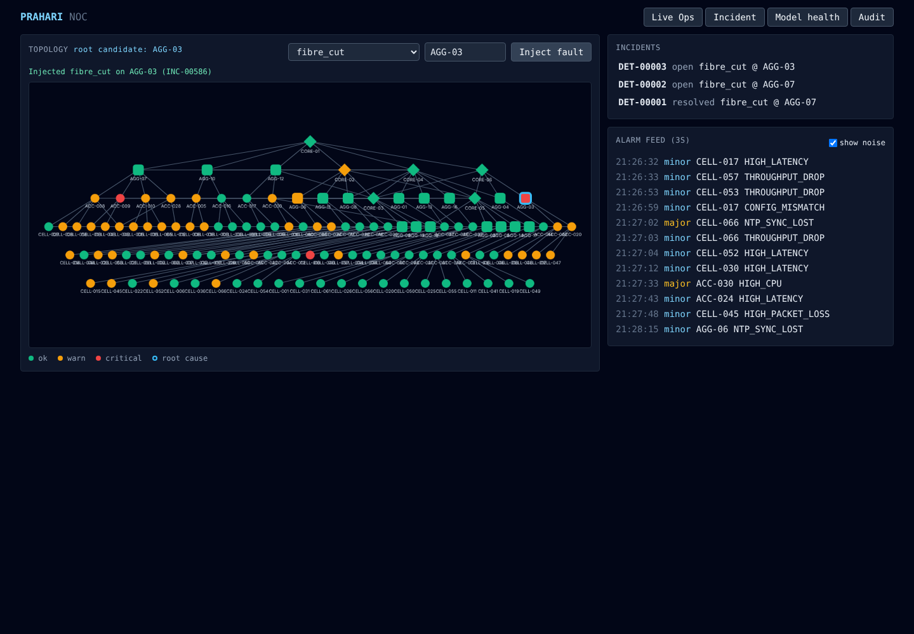
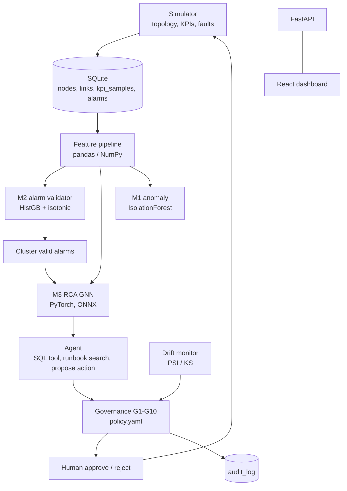
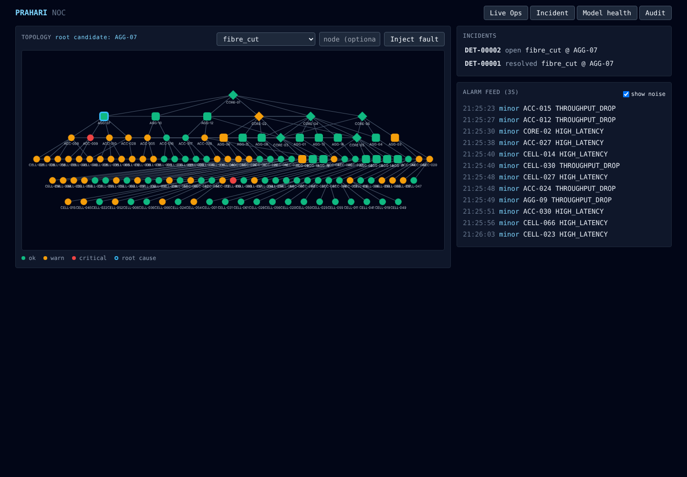
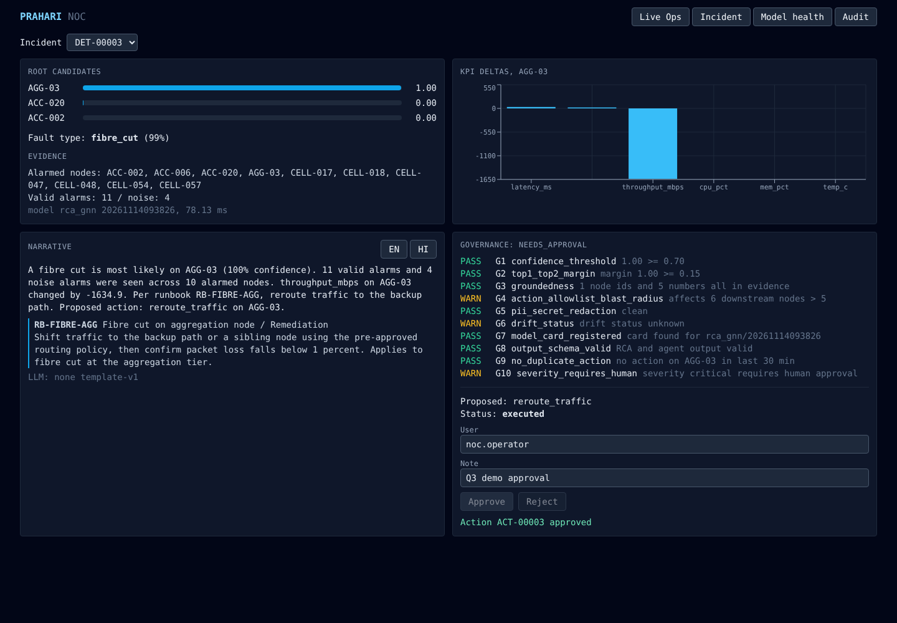
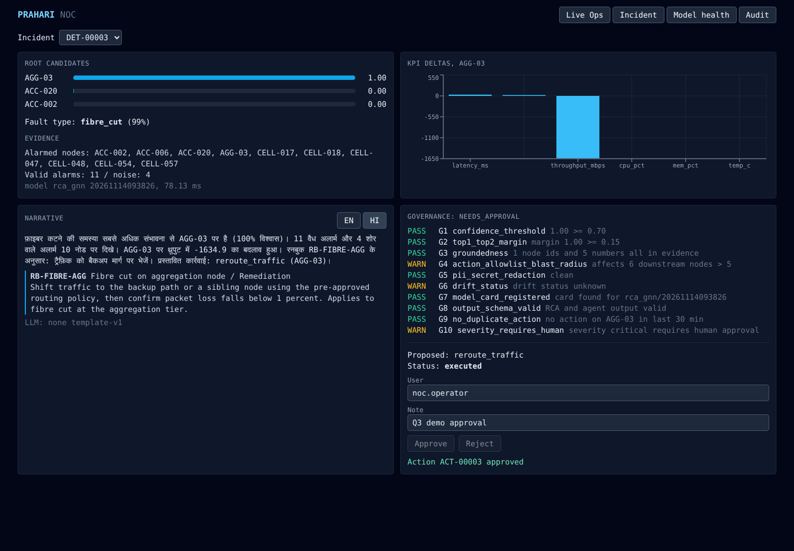
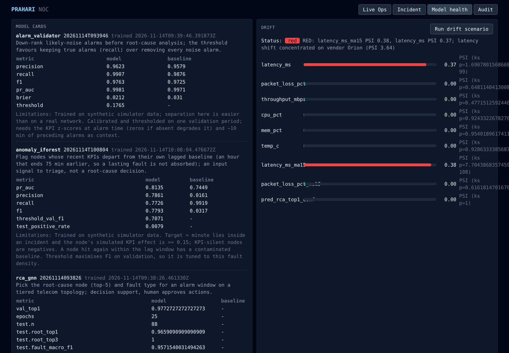
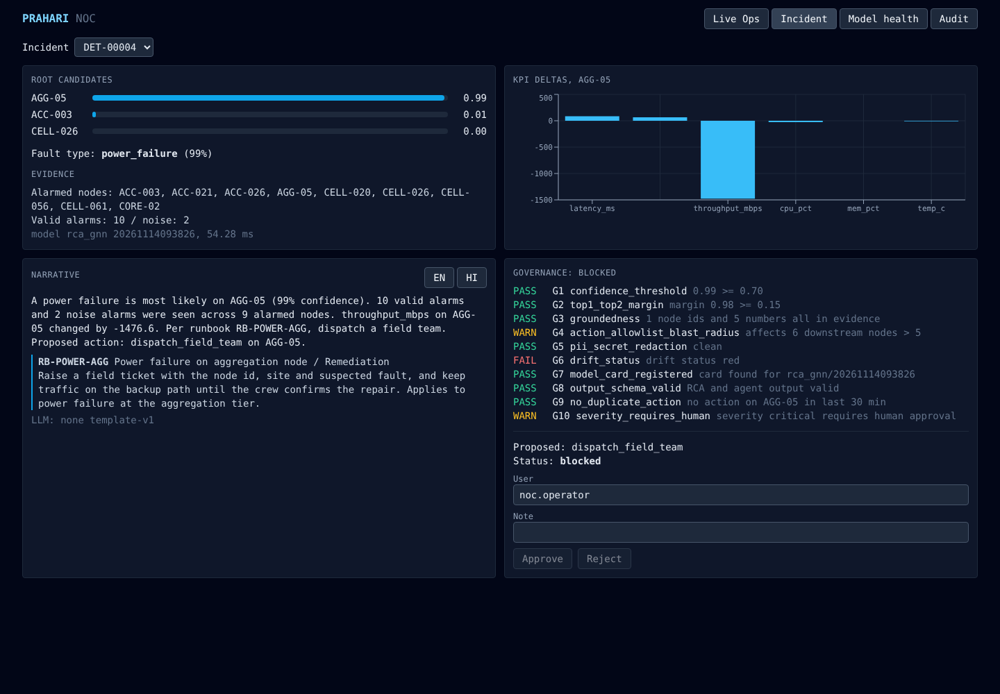
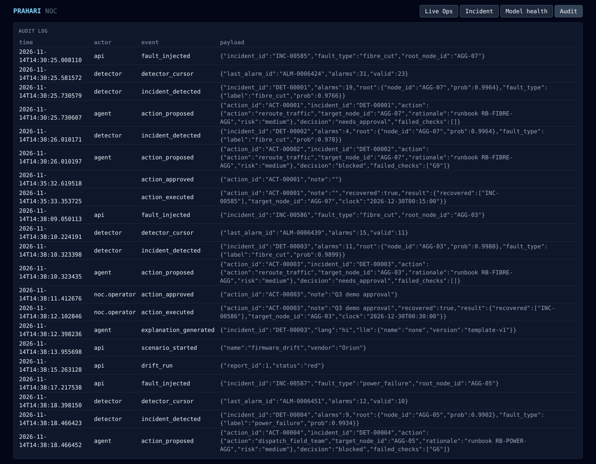

<div align="center">

# PRAHARI · प्रहरी

**A human-in-the-loop network-operations copilot for telecom.**
It filters noise alarms, finds the root cause of an alarm storm with a graph neural network,
proposes a fix, and asks a human before it acts.

[](https://github.com/Nakulraj-23/prahari/actions)




</div>

> **In plain words:** when a cable is cut, dozens of devices send alarms at once and most are noise.
> PRAHARI ignores the noise, works out which device is the real source, suggests a fix with a reason
> (in English or Hindi), runs 10 safety checks, and lets a person press Approve.
> **All data is synthetic**, produced by a simulator in this repo. No result here is real-network accuracy.

**Contents:** [What it does](#what-it-does) · [Quickstart](#quickstart) · [Results](#results-seed-42-chronological-test-split-synthetic-data) ·
[Architecture](#architecture) · [Screenshots](#screenshots) · [Limitations](#limitations-honest-list) ·
[Docs](#documentation) · [Live demo](#live-demo-free-vercel)

## What it does

1. A simulator builds a 120-node telecom topology (core, aggregation, access, cell), 6 KPIs per node per minute, and faults that spread downstream with true and noise alarms.
2. **Alarm validator** (gradient boosting, calibrated) marks each alarm as real or noise.
3. Valid alarms are clustered into an incident.
4. **RCA GNN** (a graph convolutional network written by hand in PyTorch) ranks the root-cause node and predicts the fault type.
5. An **agent** looks up a runbook (TF-IDF search), proposes an action and writes an explanation in English or Hindi.
6. A **governance gate** runs 10 checks (confidence, groundedness, blast radius, PII, drift, model card, ...). A human approves or rejects.
7. A **drift monitor** (PSI and KS, written in NumPy) can turn red; then governance blocks actions.
8. FastAPI serves it all; a React dashboard sits on top. An **anomaly detector** (IsolationForest) scores node KPIs as a separate triage signal.

## Quickstart

Needs Python 3.11 and Node.js (for the dashboard). Times below are from a clean clone (Q3 system test).

```bash
make setup          # venv + pip install -e ".[dev]"   (~2.5 min)
make seed train     # build the 90-day database and train all 3 models (~10 min)
make serve          # API on http://localhost:8000  (OpenAPI docs at /docs)
make web            # dashboard on http://localhost:5173
```

Read this before you run it:
- `make seed train` is required after a clone. It writes `prahari.db` (**about 2.3 GB**) and `prahari_alt.db`, and model files in `artifacts/`. All are **git-ignored**. Only the model cards (`artifacts/**/*.card.json`) are committed.
- `make web` uses **mock data** from `fixtures/` by default. To use the real API, run `VITE_MOCK=0 make web` while `make serve` is running.
- `make test` runs the Python tests. Without the database, tests that need it are skipped (147 pass, 21 skip on a clean clone; 167 pass, 1 skip after `make seed train`).
- `make bench` writes `docs/bench.md` (ONNX benchmark).
- The LLM provider is `none` by default: narratives come from templates and work offline.

Demo path in the dashboard: Live Ops → Inject fault → open the incident → read the governance list → Approve → switch EN/HI → Model health → Run drift scenario → inject again (now blocked).

## Results (seed 42, chronological test split, synthetic data)

| Model | Metric (test) | Model | Baseline | Read it as |
|---|---|---|---|---|
| RCA GNN | root top-1 (88 incidents) | 96.6% | MLP without graph 95.5%; rules 73.9% / 58.0% | Over 10 seeds the GNN beats the MLP by **+1.0 pt only (p about 0.07)**. Not significant. |
| RCA GNN | root top-3 | 100% | MLP 100% | |
| RCA GNN | fault-type macro-F1 | 0.957 | MLP 0.938 | 10-seed means: 0.949 vs 0.951, no gain. |
| RCA GNN | unseen 80-node topology, top-1 (47 incidents) | 100% | MLP 97.9% | Small sample. |
| Alarm validator | precision / recall at threshold 0.18 | 0.962 / 0.991 | LogReg 0.958 / 0.988 | The 0.998 PR-AUC reflects a simulator shortcut. Honest number: **noise-class AP 0.9675**. |
| Anomaly IForest | PR-AUC / F1 (407,640 node-minutes) | 0.8135 / 0.779 | 3-sigma tuned on val: 0.745 / **0.809** | **The tuned 3-sigma rule beats the forest on F1.** Recall is 0.45 in the first 5 min. |

System numbers:

| What | Measured |
|---|---|
| Live detection, 10 injected faults | 8 detected, root and fault type 8/8 correct, **2 missed** (leaf faults with fewer than 2 valid alarms) |
| RCA forward pass, 120 nodes, 1 thread | PyTorch p50 0.244 ms, ONNX fp32 0.135 ms, ONNX int8 0.122 ms (43 KB vs 113 KB, same accuracy) |
| RCA end-to-end predict (DB query + features + forward) | p50 42.2 ms, p95 142.9 ms |
| `/v1/alarms/validate` under load, one worker | p50 56 ms at 1 client, 4300 ms at 32 clients (0 errors) |
| Drift, `firmware_drift` scenario | red, latency PSI 0.44 (0.37 in the Q3 run); normal 6 h windows 42/43 green |

Sources: model cards in `artifacts/`, `docs/handoffs/`, `docs/bench.md`, `docs/loadtest.md`, `docs/EXPERIMENTS.md`.

## Architecture



Full description, data flow and design decisions: [docs/ARCHITECTURE.md](docs/ARCHITECTURE.md).

## Screenshots

| | |
|---|---|
|  Healthy network |  Alarm storm, noise greyed, root ringed |
|  RCA, narrative, 10 governance checks |  Approved and executed |
|  Hindi narrative |  Drift scenario turns red |
|  New action blocked by G6 |  Audit log |

## Limitations (honest list)

- **Synthetic data only.** The simulator was first too easy: an audit (Q1) found one KPI feature gave AUC 0.976 for alarm validity. The simulator was fixed (0.846 after), but some shortcuts remain.
- **The graph adds little.** GNN vs no-graph MLP: +1.0 pt root top-1 over 10 seeds, p about 0.07, no gain on fault type. Most of the signal is in the node features.
- **Validator is near ceiling because of the simulator.** Test noise alarms never have a neighbour alarm in the prior 5 min. Report noise-class AP 0.9675, not the 0.998 PR-AUC.
- **Anomaly detector loses to a tuned rule on F1** (0.779 vs 0.809) and is slow at fault onset.
- **2 of 10 live faults were not detected** (leaf faults with fewer than 2 valid alarms).
- **Validate latency degrades under load** on one worker (p50 4.3 s at 32 clients).
- **Docker was never built or run.** Postgres is untested; the SQL guard's second layer is SQLite-only.
- LLM providers (`anthropic`, `openai_compatible`) were tested only against fake transports.
- Small test sets: 88 test incidents, 47 on the second topology.

What production would need: real alarm and topology data with root-cause labels, Postgres and several workers, a streaming ingest (e.g. Kafka), per-vendor retraining with drift triggers, a real LLM behind the groundedness check, and auth on the API.

## Repo map

`prahari/sim` simulator · `prahari/pipeline` features and data quality · `prahari/models` M1-M3 · `prahari/agent` agent · `prahari/governance` checks · `prahari/serving` API · `prahari/monitoring` drift, bench, load test · `web/` dashboard · `tests/` · `docs/` (architecture, experiments log, handoffs, interview guide).

## How it was built

With an AI-assisted multi-agent workflow (builder agents and independent audit agents, see `docs/plan/` and `docs/handoffs/`). The problem, scope and design choices are the author's. Every failed approach is logged in `docs/EXPERIMENTS.md`.

## Live demo (free, Vercel)

The dashboard can be hosted as a static **demo replay**: it shows data captured from a real run
of this system (real topology, real incident, real governance report, real model cards and drift
report) from `web/demo-data/`. The buttons do not change a backend. The full system (API, models,
2.3 GB database) runs locally as described above.

Deploy: Vercel, Add New Project, import this repo, set **Root Directory** to `web`, Deploy.
`web/vercel.json` already sets the build command. Or from `web/`: `npx vercel --prod`.
Local preview: `cd web && DEMO_DATA=1 VITE_MOCK=1 VITE_DEMO=1 npm run build && npx vite preview`.

## Documentation

| Read this | For |
|---|---|
| [docs/EXPLAIN_LIKE_IM_5.md](docs/EXPLAIN_LIKE_IM_5.md) | The whole project in plain language, with test results per component |
| [docs/ARCHITECTURE.md](docs/ARCHITECTURE.md) | Components, data flow, design decisions and rejected alternatives |
| [docs/INTERVIEW_GUIDE.md](docs/INTERVIEW_GUIDE.md) | Concepts from first principles and a 67-question bank |
| [docs/EXPERIMENTS.md](docs/EXPERIMENTS.md) | Every failed attempt and what was learned |
| [docs/bench.md](docs/bench.md) · [docs/loadtest.md](docs/loadtest.md) | Latency, model size and load-test numbers |

## Audit and fix loop

Three independent reviews (data, models, system) found real problems that were fixed and re-tested:
a too-easy simulator, an anomaly baseline that absorbed lasting faults, a governance gap that let a
low-confidence fault type through, and database locking under load. Details in `docs/handoffs/` and `docs/EXPERIMENTS.md`.

## License

MIT, see [LICENSE](LICENSE).
